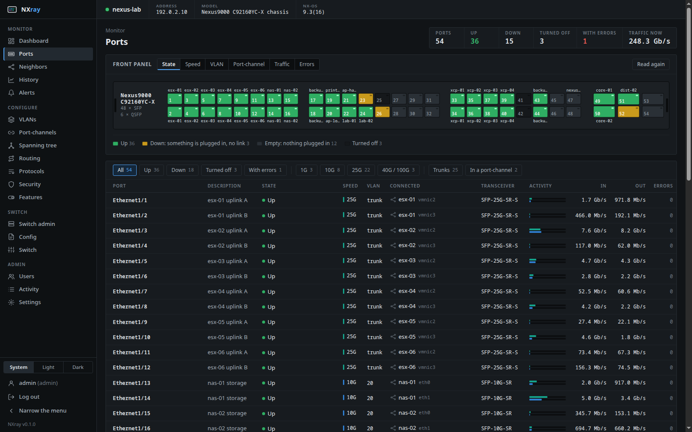
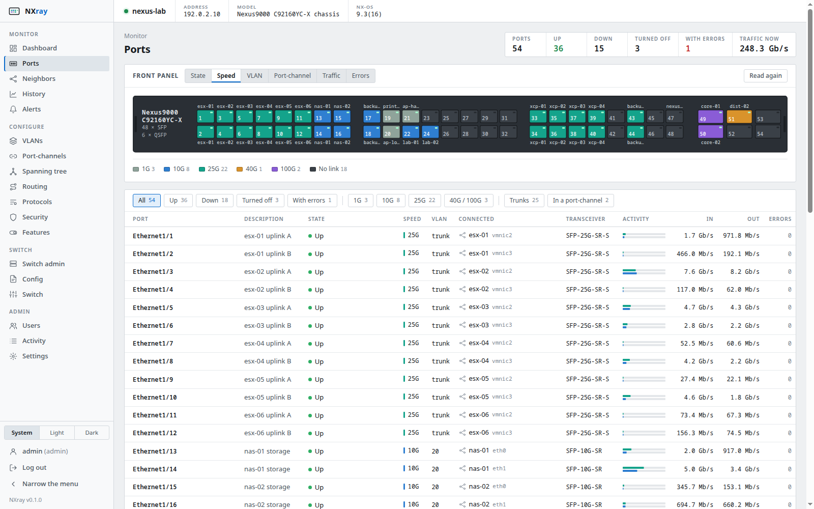
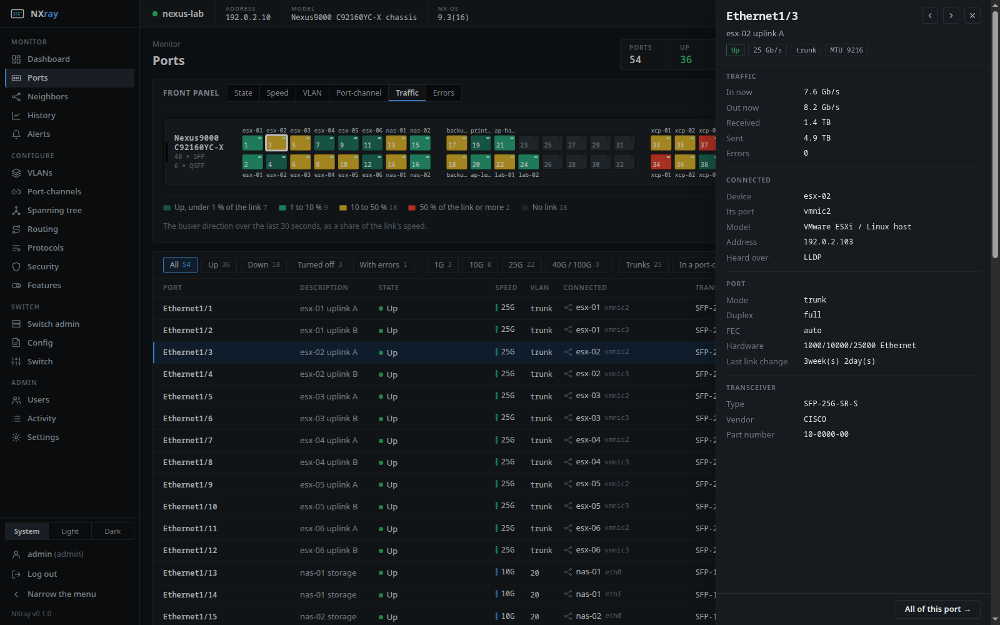
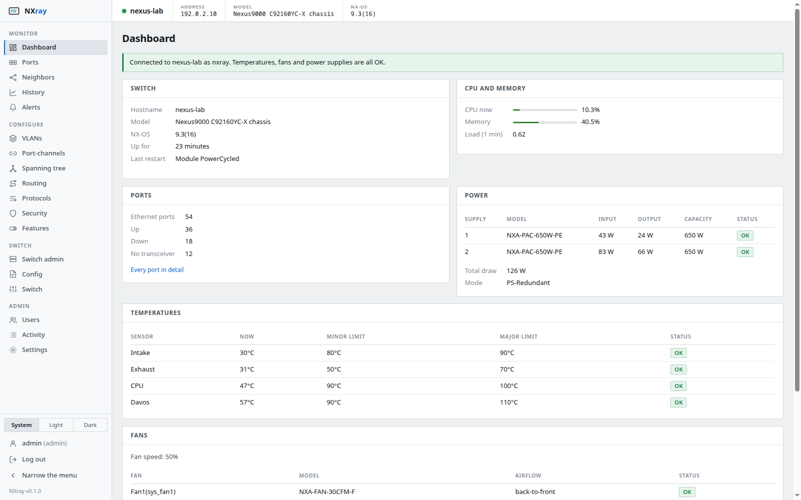
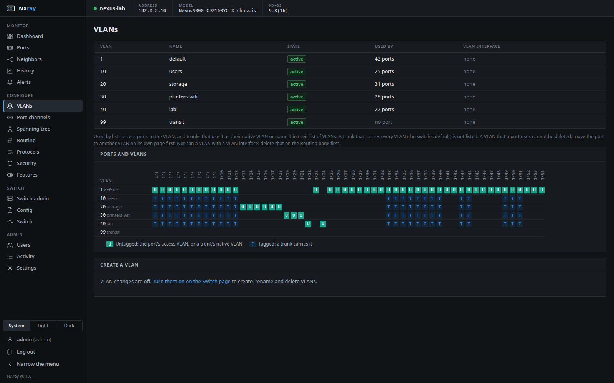

# NXray

[](https://github.com/acebmxer/nxray/actions/workflows/ci.yml)
[](LICENSE)
[](pyproject.toml)
[](docker-compose.yml.example)
[](https://github.com/acebmxer/nxray/actions/workflows/ci.yml)
[](https://github.com/acebmxer/nxray/actions/workflows/ci.yml)
[](https://github.com/acebmxer/nxray/actions/workflows/ci.yml)

A web interface for monitoring and managing Cisco Nexus switches through
NX-API, so everyday checks and changes don't need an SSH session.

Built and tested against a Nexus 9000 (N9K-C92160YC-X) on NX-OS 9.3.



**Status:** early. All 20 stages of the [roadmap](#roadmap) are built. Today
you can install NXray, sign in, connect it to one switch or several and pick
the one every page shows from the top bar,
see the switch's health on the dashboard, look at every port on a picture of
the front panel coloured by state, speed, VLAN, port-channel, traffic or errors, see what is
plugged into each port (CDP and LLDP neighbors, the MAC address table with
each device's maker, ARP), turn CDP and LLDP on or off per port, set the MAC
address aging time, add static MAC addresses, clear learned ones, label ports, turn
ports on or off and edit their descriptions (one at a time or several at once), create, rename and delete VLANs, set the
VLANs on ports, set up private VLANs (primary, isolated and community, with host and
promiscuous ports), turn UDLD on per port and see its neighbors, set the VTP mode, domain
and version, set up 802.1X sign-in on ports and see the devices signed in, measure delay,
jitter and loss from the switch with IP SLA entries and see their results, choose which
problems shut a port down (errdisable) and which let it come back by itself, set a port's speed, MTU, FEC, flow control, storm control and
layer (switched or routed), split a 100G port into four, make, change and
delete port-channels with their LACP options, make VLAN interfaces with IPv4
and IPv6 addresses, make loopbacks with their addresses, make GRE and IP-in-IP tunnels, make VRFs and move interfaces between them, add static routes, run OSPF,
OSPFv3, BGP, EIGRP, RIP, IS-IS, HSRP, VRRP, PIM, MSDP and BFD with their
route-maps, prefix-lists and key chains, send chosen traffic to its own next hop
(policy-based routing), spread traffic over servers with ITD, steer it through firewalls and other appliances with enhanced policy-based routing, set up static MPLS labels and Layer 3 VPNs over segment routing,
translate addresses with NAT (static and dynamic, once the switch has TCAM space for it), make tracked objects that
follow an interface, a route or an IP SLA entry for HSRP, VRRP and EEM, reserve bandwidth for
media multicast with non-blocking multicast,
set up spanning tree (mode, VLAN
priorities, the MST region, edge ports, BPDU guard and filter, root and loop
guard), set up vPC (domain, peer keepalive, peer-link, vPC port-channels) and VXLAN
with EVPN (NVE interface, VNIs, route-targets), route multicast across it, encrypt it
between sites (on the Nexus 9300-FX2) and ping, traceroute and pathtrace across it, set up IGMP
snooping per VLAN (queriers, router ports, static groups) and clear what it learned, pair a
port with a backup that takes over at once (Flex Links, on the Nexus 9300 models that do
them), follow VMware VMs to their ports from vCenter with VM Tracker, see the VMs servers
announce over Edge Virtual Bridging, copy ports' or VLANs' traffic to a
port or an analyzer (SPAN and ERSPAN), mark, limit and queue traffic with QoS
class-maps and policy-maps, set each port's priority flow control and read its pause
counters, see the control-plane policing (CoPP) policy with what each class passed and
dropped, set the switch's hostname, banner,
clock and NTP, DNS, logging and
SNMP and read its log, have the switch run jobs on a schedule (such as a nightly copy of its
configuration) and act on events with EEM applets, send its messages with Smart Call Home, take precise time from a PTP grandmaster and pass it on, stream its data to a collector with telemetry, set how people sign in to it (its own accounts, RADIUS or TACACS+) and what is recorded, see and replace its SSH host key and manage its certificates, browse, copy and delete the files on its bootflash, check and install a new NX-OS image, collect show tech-support for a support case, make and apply IPv4, IPv6 and MAC ACLs, object groups
and VLAN access maps, size the TCAM regions, set port security, DHCP snooping,
the DHCP relay, dynamic ARP inspection and IP Source Guard, keep backups of the
switch's configuration, compare them and roll back to one, restart the switch,
see who changed what in an activity log, be told by e-mail or webhook
(JSON, Slack or Discord) when the switch cannot be reached, runs hot, loses a
fan or power supply, runs out of CPU or memory, or a port goes down or
collects errors, turn switch features
such as LLDP on and off, change the switch's address or repair NXray's switch login
from the web interface, and give other people their own NXray accounts as
admin, operator or viewer, each with optional two-factor sign-in, turn on
built-in HTTPS, update from the Settings page, see 30 days of temperatures,
power, CPU, memory and port traffic as graphs, and measure traffic per VLAN and
per device, trunks included, with NXray as the switch's sFlow collector.

## Screenshots

Taken against the test suite's pretend switch, with made-up devices.

| | |
| --- | --- |
|  |  |
| Ports coloured by speed (light theme) | Clicking a port opens its side panel |
|  |  |
| The dashboard | VLANs against ports: U untagged, T tagged |

## Read next

| Page | What it covers |
| --- | --- |
| [Installation](docs/installation.md) | Getting the container running |
| [Configuration](docs/configuration.md) | Every setting, its default and what it does |
| [Switch setup](docs/switch-setup.md) | What setup does on the switch, and how to undo it |
| [Live figures](docs/live.md) | Pages that refresh themselves: the intervals, what it costs the switch, what Live measures |
| [Traffic per VLAN and per device](docs/traffic.md) | What the estimates mean and what they leave out, and measuring them with sFlow on the Traffic page |
| [Function index](docs/functions.md) | Every function in the codebase, in one place |
| [Contributing](CONTRIBUTING.md) | Development setup and conventions |
| [Security](SECURITY.md) | Threat model and reporting a vulnerability |
| [Changelog](CHANGELOG.md) | What changed in each version |

## Quick start

On a Linux machine with Docker and Compose 2.30 or newer:

```bash
mkdir nxray && cd nxray
curl -o docker-compose.yml https://raw.githubusercontent.com/acebmxer/nxray/main/docker-compose.yml.example
curl -o nxray.env https://raw.githubusercontent.com/acebmxer/nxray/main/nxray.env.example
docker compose run --rm nxray python -m app.hashpw   # paste the printed line into nxray.env
docker compose up -d
```

Then open `http://<that machine>:8080` and sign in. The full steps are in
[Installation](docs/installation.md).

## Requirements

- Linux with Docker Engine and the Compose plugin, 2.30 or newer.
- A Cisco Nexus switch with NX-API turned on (`feature nxapi`), reachable from
  the Docker host on port 443. Turning on port changes also needs the
  switch's SSH (port 22) reachable from the Docker host, once.

## How it talks to the switch

Through NX-API, the switch's own HTTPS interface: the same commands you
type over SSH, answered as structured data. NXray uses its own account on
the switch, never `admin`: the Switch page signs in with the admin login
once, creates that account with a long random password, gives it a role that
allows only the changes NXray makes (untick **Also turn on changes** to keep
it read-only), saves the switch configuration, and keeps only that account's
login. The admin password is never stored, unless you choose the role mode that
stores it (see [How much access NXray's account gets](docs/switch-setup.md#how-much-access-nxrays-account-gets)).
See [Switch setup](docs/switch-setup.md).

Once a switch is set up, NXray also reads it every minute (four read-only
commands) to record history; see [Installation](docs/installation.md#history).

Turning on port changes is the one step that uses SSH: NX-API cannot create
the role that lets NXray's account change the front ports and the VLANs (and
nothing else), so NXray types it in over SSH with the admin login, once.

The switch's self-signed HTTPS certificate is accepted without checking; see
[SECURITY.md](SECURITY.md) for what that means.

## Roadmap

The goal is for NXray to do everything the switch offers. Anything found
along the way that no stage below covers is added to the stage it fits best.

1. **Groundwork**: install, sign in, empty dashboard. *(built)*
2. **Switch setup**: a setup page that connects to the switch and creates
   NXray's own read-only account on it; clear messages when the switch can't
   be reached or refuses the login; a "Test connection" button. *(built)*
3. **Dashboard**: hostname, model, NX-OS version, uptime, temperatures against
   their limits, fans, power supplies and power draw, CPU and memory, port
   counts. *(built)*
4. **Ports page**: every port's state, speed, VLAN, description, transceiver,
   traffic and error counters. Read-only. *(built)*
5. **Port changes**: turn a port on or off and edit its description, with a
   confirm step, plus "Save config". *(built)*
6. **VLANs**: create, delete and rename VLANs; set the VLANs on ports.
   *(built)*
7. **Switch settings in the web interface**: change the switch address or run
   setup again. *(built)*
8. **HTTPS, more users, two-factor sign-in, self-update, published images.**
   More users with admin, operator and viewer roles: *(built)*. Optional
   two-factor sign-in per account: *(built)*. Built-in HTTPS, off by
   default: *(built)*. Published images on GHCR: *(built)*. Self-update, off by
default: *(built)*.
9. **History**: temperatures, power, fans, CPU, memory and port traffic and
   errors over time, as graphs. *(built)* Traffic per VLAN and per device,
   estimated from the ports' own counters: *(built)*. Measured per VLAN and
   per device, trunks included, with NXray as an sFlow collector: *(built)*.
10. **Switch face**: a picture of the front panel with every port colored by
    state, speed, VLAN, port-channel, traffic or errors; hover for details,
    click to open the port's side panel, which makes every change to the port;
    your own labels on ports. *(built)*
11. **Port settings**: speed, duplex, MTU and jumbo frames, FEC, breakout,
    storm control, flow control, layer 2 or layer 3 per port. *(built)*
12. **Neighbors and tables**: LLDP and CDP neighbors, MAC address table, ARP,
    which device is on a port, with each device's maker. *(built)* Changes:
    CDP and LLDP on or off per port, the MAC aging time, static MAC
    addresses, clearing learned addresses. *(built)*
13. **Features**: turn switch features on and off. *(built)*
14. **Link aggregation**: port-channels and LACP. *(built)*
15. **Layer 3**: VLAN interfaces and IPv4 and IPv6 addresses on them and on
    routed ports: *(built)*. VRFs: *(built)*. Static routes: *(built)*. Routing
    protocols: *(built)* **Loopbacks**: made, described, addressed, moved into a
    VRF, on or off. *(built; needs the broad role or a stored admin login)*
    **Tunnels**: GRE and IP-in-IP tunnel interfaces with their mode, source,
    destination, VRFs and address. *(built, not yet tried on a switch; needs the
    stored admin login)* **Policy-based routing**: route-maps that send matched
    traffic to their own next hops, the interfaces they apply to, their counters.
    *(built; needs the broad role or a stored admin login)* **ITD**: device groups
    with nodes and health probes, services that spread traffic over them, the
    counters. *(built; needs the broad role or a stored admin login)* **MPLS**:
    static labels (the feature set, label range, MPLS on interfaces, bindings that
    swap or pop a label) and Layer 3 VPNs over segment routing (the global block,
    prefix SIDs, each VRF's route distinguisher and route-targets, with the VPN
    address families on the BGP page). *(built, not yet tried on a switch; needs the
    broad role or a stored admin login)* **NAT**: inside and outside interfaces,
    static translations (addresses or TCP and UDP ports, in a VRF, with a route),
    pools, dynamic translations to a pool or an interface's address, timeouts and
    limits, the translations and counters, clearing them, and whether the switch has
    TCAM space for NAT. *(built; needs the broad role or a stored admin login; the
    translation, pool, timeout and clear lines tried on a switch; inside and outside
    on an interface not, since the switch refuses them while its NAT TCAM region is
    0, as on cisco-25gb)* **Tracked objects**: objects that follow an interface, a
    route, an IP SLA entry or a list of others (all, any, by weight or percentage),
    with their wait, VRF and state, for HSRP, VRRP and EEM. *(built; needs the broad
    role or a stored admin login)* **Enhanced policy-based routing (ePBR)**: services
    of appliances with their end-points, reverse end-points and probes, policies whose
    ACL matches send traffic through a chain of services, spread over the end-points,
    where they apply, each end-point's state and the counters; services and policies in
    use are changed in an ePBR session. *(built; needs the broad role or a stored admin
    login; tried on a switch, the 92160YC-X takes ePBR)* **Non-blocking multicast (NBM)**:
    the mode and default flow settings, flow policies with their groups' bandwidth, mark,
    policer and priority, which senders and receivers may use them, flow definitions,
    external links, per NBM VRF too, with the flows and each interface's bandwidth left.
    *(built; needs the broad role or a stored admin login; tried on a switch, the 92160YC-X
    takes NBM, but Cisco does not support it with VXLAN on, and it needs TCAM space carved
    with a restart, which the page says)*
16. **Spanning tree.** *(built)* **vPC**: domain, peer keepalive, peer-link and
    vPC port-channels, with the pair's health. *(built)*
    **VXLAN and EVPN**: NVE interface, VNIs, EVPN route-targets, with the
    tunnels' health. *(built)*
    **Multicast over VXLAN EVPN (tenant routed multicast)**: the switch-wide choices, the
    NVE interface's multicast source, each layer 3 VNI's group, each VRF's flow spreading and
    MVPN route-targets, BGP's ipv4 mvpn and l2vpn evpn families (on the BGP page for the
    neighbors). *(built; needs the broad role or a stored admin login; the feature and the
    switch-wide, VRF and NVE lines tried on a switch, the route-target, layer 3 VNI and BGP
    lines not, since they need BGP and EVPN running)*
    **VXLAN tunnel encryption (CloudSec)**: key chains and keys, the source loopback,
    encrypted traffic only, the integrity check, policies, peers with their key chain and
    policy or certificates, the links that encrypt, with the sessions. *(built from Cisco's
    guide; needs the broad role or a stored admin login; the N9K-C92160YC-X does not do it:
    it refuses the feature, and the page says so; Cisco lists it for the Nexus 9300-FX2
    only; the key chain lines tried on a switch, the rest not tried live)*
    **VXLAN OAM (NGOAM)**: ping, traceroute and pathtrace across the fabric (to an address
    in a VNI or VRF, a host found by its traffic, or a MAC address) with the switch's
    answer shown, OAM profiles and flows, the OAM access list, authentication key, cross
    connect heartbeat, loop detection and its probe and bring-up, the tools' counters.
    *(built; needs the broad role or a stored admin login, and Update the port list for a
    broad role written before; the feature, profiles, flows and every tool form tried on a
    switch with no VXLAN tunnel, so no OAM answer was seen; the OAM access list not tried
    live, since it writes into the switch's hardware access lists; loop detection refused
    by the N9K-C92160YC-X, and the page says so)*
    **IGMP snooping**: switch-wide and per VLAN, the querier and its timers, fast leave,
    explicit tracking, report suppression and flooding, router ports, static groups, report
    filters, with the groups hosts joined and each VLAN's counters, and clearing a VLAN's
    groups and counters. *(built; needs the broad role or a stored admin login; the VLAN
    lines and the clears tried on a switch, the switch-wide lines not, since they are
    settings the switch already has)*
    **Flex Links**: pairs of an active and a backup port or port-channel, with preemption
    and multicast fast convergence. *(built from Cisco's guide; needs the broad role or a
    stored admin login; not tried live: the N9K-C92160YC-X does not do Flex Links, it
    refuses the feature, and the page says so; Cisco lists them for some Nexus 9300 models
    only)*
    **VM Tracker**: vCenter connections (address, login, timers, VLANs it may make),
    connecting and syncing, VM Tracker per port, fabric auto-configuration, with the VMs on
    each port. *(built; needs the broad role or a stored admin login; the connection lines
    tried on a switch with no vCenter, so connecting, syncing and the VM list not tried)*
    **Edge Virtual Bridging**: the VDP address, timers and batch answers, with the hosts and
    VSIs servers announce. *(built; needs the broad role or a stored admin login; the page
    read on a switch, the settings not tried, since they are settings the switch already
    has)*
    **Monitor sessions**: SPAN and ERSPAN source sessions. *(built; needs the
    broad role or a stored admin login)*
    **QoS**: class-maps, policy-maps (classification, network-qos, queuing),
    where they are applied and the queue counters. *(built; needs the broad
    role or a stored admin login)*
    **Priority flow control**: each port's PFC mode and watchdog, with the pause
    counters. *(built; needs the broad role or a stored admin login)*
    **Control-plane policing**: the CoPP policy on the control plane, its
    classes and rate limits, with what each class passed and dropped. *(built;
    look only)*
    **Private VLANs**: primary, isolated and community VLANs, host and
    promiscuous ports, private VLAN trunks and the VLAN interface mapping.
    *(built; needs the broad role or a stored admin login)*
    **UDLD**: per port and switch-wide, with each port's state and neighbours.
    *(built; needs the broad role or a stored admin login)*
    **VTP**: mode, domain, version and password, and the ports taking part.
    *(built; needs the broad role or a stored admin login)*
    **802.1X**: RADIUS server groups, port control, host mode, MAC
    authentication bypass and timers per port, with the devices signed in.
    *(built; needs the broad role or a stored admin login)*
    **IP SLA**: entries that measure from the switch (ping, UDP echo and
    jitter, TCP connect, DNS, HTTP), their schedules, reactions and results.
    *(built; needs the broad role or a stored admin login)*
    **Errdisable**: which causes shut a port down and which recover by themselves, the
    recovery interval, the ports err-disabled now. *(built; needs the broad role or a
    stored admin login)*
17. **Switch admin**: hostname, clock and NTP, DNS, logging and a viewer for
    the switch's own log, SNMP, banner. *(built)* **Scheduler**: jobs from a
    menu of commands, their schedules and log. *(built; needs the broad role or
    a stored admin login)* **EEM**: applets with their events and actions,
    environment variables, the system policies. *(built; needs the stored admin
    login)* **Smart Call Home**: contact details, destination profiles, the
    transport, a test message. *(built; needs the broad role or a stored admin
    login)* **PTP**: the clock's source, domain, priorities and notifications,
    and PTP per port with its role, transmission and intervals, with the
    clock's and ports' state. *(built; needs the broad role or a stored admin
    login)* **Telemetry**: destination groups, sensor groups and subscriptions,
    with each collector's state. *(built; needs the broad role or a stored admin
    login)* **AAA**: how people sign in (the switch's own accounts, RADIUS or
    TACACS+ server groups), accounting and TACACS+ command authorization, the
    servers and groups. *(built; needs the stored admin login and an NXray admin;
    the sign-in, accounting and authorization lines not yet tried on a switch)*
    **SSH and certificates**: the SSH host key and a new one, key pairs,
    trustpoints, a CA certificate pasted or a PKCS#12 file imported. *(built;
    needs the broad role or a stored admin login, and an NXray admin; a new SSH
    key not yet tried on a switch)* **Files**: bootflash's files and free space,
    copy a file to or from the switch, delete one. **Software**: the running and
    boot images, an image's checksum, the switch's compatibility check, the
    install. **Tech support**: collect show tech-support and download it.
    *(built; need the stored admin login and an NXray admin; the install itself
    not yet tried on a switch)*
18. **Security and config tools**: ACLs (IPv4, IPv6 and MAC, object groups,
    VLAN access maps, TCAM regions), port security, DHCP snooping and relay,
    dynamic ARP inspection, IP Source Guard, an activity log of who changed
    what in NXray, config diff, backup, rollback and restarting the switch.
    *(built)*
19. **Alerts** by e-mail and webhook. *(built)*
20. **Several switches** in one NXray: add more on the Switch page, pick one
    in the top bar; each has its own history, port labels, backups and
    alerts. *(built)*

## Contributing

Pull requests go to the `dev` branch. Read [CONTRIBUTING.md](CONTRIBUTING.md)
for the setup and conventions, use the issue templates for
[bug reports and feature requests](https://github.com/acebmxer/nxray/issues/new/choose),
report vulnerabilities privately as described in [SECURITY.md](SECURITY.md),
and follow the [Code of Conduct](CODE_OF_CONDUCT.md).

## License

[MIT](LICENSE)
